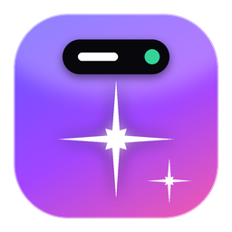

<p align="center"></p>

# Assistente

Deixa o Windows com cara de Mac: uma **Dynamic Island** no topo da tela, **dock** embaixo, barra de menus, menus nos cantos, tela personalizada com atalhos e um painel com ferramentas úteis do dia a dia.

## Como instalar (sem precisar entender de programação)

1. Abra a página de [versões (Releases)](https://github.com/LeonardoSbrolini/os-assistant/releases/latest).
2. Em **Assets**, baixe o **`Assistente.exe`** (versão completa, funciona em qualquer Windows 10/11).
   - Já tem o *.NET 8 Desktop Runtime*? Pode baixar o `Assistente-leve.exe`, que é bem menor.
3. Coloque o arquivo numa pasta fixa (ex.: `Documentos\Assistente`) e dê dois cliques nele.
   - Se o Windows mostrar "O Windows protegeu o computador", clique em **Mais informações › Executar assim mesmo** (o app não tem assinatura paga da Microsoft).
4. Pronto: a ilha aparece no topo e o ícone ✦ fica na bandeja (perto do relógio). Para abrir junto com o Windows: **Configurações › Geral › Iniciar com o Windows**.

**Atualizações:** o app se atualiza sozinho (confere ao abrir e a cada 6 horas). Para forçar: ícone da bandeja › *Verificar atualizações*.

**Desinstalar:** feche pelo ícone da bandeja › *Sair* e apague o `.exe`. As configurações ficam em `%APPDATA%\Assistente` (pode apagar também).

## Como usar

| Quero… | Faça isto |
|---|---|
| Abrir as ferramentas (Sistema, Chat IA, Música…) | Clique em **Ferramentas** na ilha do topo, ou dois cliques no ícone da bandeja |
| Copiar de novo algo do Ctrl+C | Ilha do topo › aba **Copiados** › clique no item |
| Trocar o avatar (ou usar sua foto) | Clique no avatar na aba Início da ilha, ou Configurações › Avatar |
| Ver o calendário | Clique em qualquer data ou hora (barra do topo, ilha, menu do canto, tela personalizada) |
| Mudar como a ilha abre (menu pequeno ou grande) | Configurações › Ilha e menus |
| Ver Wi‑Fi, volume, bateria e notificações | Leve o mouse ao canto de baixo à direita da tela |
| Abrir seus apps e pastas favoritos | Com a área de trabalho à vista, encoste o mouse na borda esquerda |
| Colocar atalhos no meio da área de trabalho | Configurações › Tela personalizada e arraste apps, pastas ou sites para o widget |
| Trocar o papel de parede (e manter mesmo com política da empresa) | Configurações › Papel de parede |

A barra de menus do topo só aparece com a **área de trabalho** na frente; com um app aberto ela some sozinha. Com dois monitores, escolha em Configurações se a ilha e o dock ficam só na tela principal, em todas ou em uma tela específica; cada tela some e volta sozinha, sem ser afetada pelo que você faz na outra.

## Por que C# + .NET 8 + WPF

- **Nativo do Windows**: acesso direto a CPU, memória, discos e processos (APIs do Windows) sem bibliotecas extras.
- **Leve**: abre rápido e usa pouca memória, diferente de Electron (que embute um navegador inteiro).
- **Janela sempre por cima, transparente e fora do Alt+Tab** são recursos simples no WPF.
- **Instalação sem .NET**: o build gera um `.exe` único que já inclui o runtime.

## Funcionalidades (MVP)

| Categoria | Ferramenta | O que faz |
|---|---|---|
| Sistema | Visão geral | Nome do PC, Windows, processador, uso de CPU e RAM ao vivo, discos e volumes com espaço livre, tempo ligado |
| Sistema | Desempenho | Gráficos do último minuto (estilo Gerenciador de Tarefas): CPU total e por núcleo, memória, disco e rede |
| Sistema | Hardware | Detalhes estilo CPU-Z: processador (cache, clock, soquete), placa-mãe e BIOS, cada pente de memória, GPU, discos (SSD/HDD, NVMe/SATA), sistema |
| Sistema | Processos | Lista estilo Gerenciador de Tarefas (memória e CPU por processo), filtro, finalizar processo, abrir local do arquivo |
| Calculadoras | Calculadora | Expressões com `( ) ^ %`, teclado na tela, histórico |
| Calculadoras | Juros compostos | Valor inicial + aporte mensal, taxa ao mês/ano, prazo em meses/anos, tabela mês a mês |
| Calculadoras | Regra de três | Direta e inversa |
| Calculadoras | Porcentagem | X% de Y, quantos % é, variação, aumento/desconto |
| Geradores | CPF, CNPJ e RG | Gera em lote (com ou sem pontuação, CPF por estado) e valida, inclusive o CNPJ alfanumérico |
| Utilitários | Histórico de cópias | Guarda tudo que é copiado (Ctrl+C) enquanto o app está aberto, com busca; um clique copia de novo (com animação), lista compacta com rolagem. Só em memória, ignora cópias marcadas por gerenciadores de senha |
| Tempo | Timer | Contagem regressiva com atalhos (1 a 60 min); ao terminar o alarme toca até ser silenciado (máx. 1 min) e mostra notificação |
| Tempo | Cronômetro | Iniciar/pausar, voltas, copiar voltas |
| Utilitários | Gerador de senhas | Gerador criptográfico, escolha de caracteres |
| Utilitários | UUID / GUID | Em lote, com opções de formato |
| Chat IA | Conversa | Chat com IA gratuita (Pollinations, sem cadastro) ou com a sua chave (Groq, OpenRouter, OpenAI…) |
| Música | Tocando agora | Controla YouTube Music, Spotify e outros players pelo controle de mídia do Windows: capa, título, progresso, tocar/pausar, anterior/próxima, volume |

As ferramentas ficam agrupadas na barra lateral (Sistema, Chat IA, Música, Ferramentas, Calculadoras, Tempo) e cada grupo tem sub-abas.

**Barra de tarefas com cara de Mac** (Configurações › Barra de tarefas): ícones no centro, sem pesquisa/visão de tarefas/widgets/chat e ocultar automaticamente, usando os ajustes oficiais do Windows; botão "Voltar como era".

**Dock estilo Mac** (Configurações › Dock, ou pelo ícone da bandeja): barra embaixo e centralizada com programas fixados e abertos, zoom nos ícones, bolinha nos abertos, clique para abrir/alternar/minimizar, botão direito para fixar, abrir nova janela ou fechar. Como no Mac, some quando uma janela encosta nele e volta ao levar o mouse até a borda de baixo; o canto direito tem Wi‑Fi, volume, bateria e relógio. O avatar do topo também sai de cena quando há uma janela embaixo dele (menos com widget de música/timer) e volta ao levar o mouse ao topo. O painel abre e fecha com um efeito "gênio" saindo do avatar.

**Ilha no topo (estilo Dynamic Island / notch)** (Configurações › Geral): uma pílula preta grudada no topo da tela, com as bordas curvas se encontrando com a borda, mostrando avatar, timer, música, CPU, bateria e hora. Ao passar o mouse ela cresce e vira um painel com abas — **Início** (música, calendário da semana com a hora e o avatar, que abre a escolha de avatar), **Copiados** (histórico do Ctrl+C: clique copia de novo), **Sistema** (CPU, memória, rede, bateria) e **Tempo** — e os botões **Ferramentas** e configurações. Cada item da ilha abre o menu dele: timer → Tempo, CPU/bateria → Sistema, hora → calendário.

**Menus nas bordas da área de trabalho** (Configurações › Geral): com a área de trabalho à vista, encostar o mouse na borda esquerda abre seus apps e pastas (adicione com "Adicionar app/pasta", remova com o botão direito); a aba **Acesso remoto** guarda conexões (Área de Trabalho Remota do Windows, TightVNC ou outro app, com usuário e senha protegida por DPAPI) e conecta com um clique; no **canto de baixo à direita** abre a central do Windows: relógio e data, Wi‑Fi, Bluetooth, notificações, bateria, volume, apps em segundo plano e atalhos (impressoras, painel de controle, gerenciador de tarefas, lixeira…). Essas funções saíram do dock.

**Menu em círculo** (Configurações › Geral): segure (arrastando) um arquivo ou app no Explorer ou na área de trabalho e clique com o botão direito: aparece um círculo em volta do cursor. Solte o arquivo numa fatia para **zipar**, **extrair** (.zip), **converter para PNG/JPG**, **reduzir 50%**, **remover fundo** ou **copiar o caminho**. Soltar no centro cancela.

**Apps em segundo plano**: a setinha "^" do dock abre um painel próprio com os apps rodando sem janela (Discord, Steam, OneDrive…). Clique abre o app; ao passar o mouse aparecem os botões de abrir a pasta e fechar o app (clique duas vezes para confirmar).

**Mini widgets** (com o painel fechado, ao lado do avatar; dá para desligar em Configurações › Geral):
- À direita: mini player quando há música tocando (capa, nome, anterior / tocar-pausar / próxima). Some depois de 10 min pausado.
- À esquerda: timer ou cronômetro rodando, com pausar/continuar e parar. Quando o timer acaba: recomeçar ou silenciar o alarme.

**Tela personalizada** (Configurações › Tela personalizada): esconde os ícones da área de trabalho e mostra um widget grande no centro da tela (na tela escolhida ou em todas) com atalhos de apps, pastas e sites em ícones grandes, relógio e data. Fundo e atalhos podem ser *Liquid glass* (o papel de parede desfocado por trás) ou *Sólido*. Arraste apps, pastas ou links para o widget; botão direito em um atalho para renomear, mover ou remover.

**Atualizações**: ao buscar atualizações, uma janelinha mostra o download com barra, porcentagem, tamanho, velocidade e tempo restante.

**Papel de parede** (Configurações › Papel de parede): uma imagem para todas as telas ou uma para cada tela, ajuste (preencher, ajustar, estender…) e degradês estilo Mac. Com **Manter** ligado, se a empresa (política de grupo do AD) ou outro programa trocar o fundo, o Assistente coloca o seu de volta: ao abrir, ao desbloquear, quando o Windows avisa da troca e a cada 30 s.

**Configurações** (botão ⚙ ou ícone da bandeja) abrem em **tela cheia** na tela onde está o mouse (ou em janela, escolha em Geral); a bolinha verde, F11 ou dois cliques no topo alternam na hora. Nelas: iniciar com o Windows, temas, cor de destaque, transparência do painel e das janelas, tamanho, animações, **20 avatares originais** (10 animados) ou **sua foto** para a alça, posição, serviço de IA e atualizações.

Também: ícone na bandeja (abrir, borda topo/direita/esquerda, posição na borda, iniciar com o Windows, sair), botão de fixar o painel aberto, e a última ferramenta usada é lembrada.

> Os documentos gerados servem apenas para testes de software.

## Como rodar

Pré-requisito: [.NET 8 SDK](https://dotnet.microsoft.com/download/dotnet/8.0) (`winget install Microsoft.DotNet.SDK.8`).

```powershell
dotnet run --project src\Assistente.App          # abre o app
dotnet test tests\Assistente.Core.Tests          # testes da lógica
```

Ou abra `Assistente.sln` no Visual Studio 2022 / Rider.

## Como gerar o instalador

```powershell
winget install JRSoftware.InnoSetup   # uma vez
.\build.ps1 -Version 0.1.0
```

Saída:
- `artifacts\publish\Assistente.exe`: executável único (dá para usar sem instalar)
- `artifacts\installer\Assistente-Setup-0.1.0.exe`: instalador em português, sem pedir administrador, com opção de iniciar com o Windows

Quando o projeto estiver no GitHub, o workflow `.github/workflows/build.yml` gera o instalador a cada push (e em tags `v*`).

## Atualização automática

O app consulta a última *release* do repositório no GitHub ao abrir e a cada 6 horas. Se houver versão maior, baixa o novo `.exe`, troca o arquivo e reabre sozinho (só quando o painel está recolhido). Também dá para forçar pelo menu da bandeja → *Verificar atualizações*.

Para publicar uma versão nova, aumente a `<Version>` em `src/Assistente.App/Assistente.App.csproj` e faça push em `main`. O workflow compila as duas versões e cria a release com `Assistente.exe` (completo) e `Assistente-leve.exe` (precisa do .NET 8 Desktop Runtime). Cada app baixa o mesmo tipo que está usando.

## Estrutura

```
src/
  Assistente.Core/          Lógica pura, sem Windows (testável)
    Documents/              CPF, CNPJ, RG
    Calculations/           Juros, regra de três, porcentagem, avaliador de expressões
    Text/                   Números pt-BR, tamanhos em bytes, senhas
  Assistente.App/           App WPF
    MainWindow.xaml(.cs)    Widget: alça na borda, expandir/recolher, lista de ferramentas
    Theme.xaml              Tema escuro (cores e estilos)
    Services/               Leitura do sistema, configurações, bandeja, iniciar com Windows
    Tools/                  Uma pasta por categoria, um arquivo por ferramenta
      ITool.cs              Contrato de ferramenta
      ToolRegistry.cs       Descobre as ferramentas automaticamente
      Ui.cs                 Construtores de UI reaproveitáveis
tests/Assistente.Core.Tests/
installer/Assistente.iss    Script do Inno Setup
build.ps1                   Testes + publish + instalador
```

## Como adicionar uma ferramenta

Crie um arquivo em `src/Assistente.App/Tools/<Categoria>/` com uma classe que implemente `ITool`. Ela aparece sozinha na lista:

```csharp
public sealed class MinhaFerramenta : ITool
{
    public string Name => "Minha ferramenta";
    public string Category => "Utilitários";
    public string Glyph => ""; // ícone Segoe Fluent Icons
    public FrameworkElement CreateView() => new UserControl
    {
        Content = Ui.Stack(Ui.Title("Olá"), Ui.Caption("Funciona!"))
    };
}
```

Se tiver lógica de cálculo, coloque em `Assistente.Core` e escreva um teste.

## Próximas funcionalidades sugeridas

**Sistema**
- Rede: IP local/público, velocidade de download/upload ao vivo, ping
- Bateria, temperatura e GPU (via LibreHardwareMonitor)
- Gráfico de histórico de CPU/RAM dos últimos minutos
- Programas que iniciam com o Windows
- Limpeza de arquivos temporários

**Calculadoras**
- Financiamento (Price e SAC) com tabela de parcelas
- Conversor de unidades (comprimento, peso, dados, temperatura)
- Datas: diferença entre datas, dias úteis, somar dias
- Salário líquido (INSS/IRRF), férias e 13º
- IMC, conversor de moedas (cotação online)

**Geradores**
- CNH, título de eleitor, PIS/NIS, RENAVAM, cartão de crédito de teste (Luhn)
- Pessoa fictícia completa (nome, endereço, CEP, telefone) e exportação para CSV/JSON
- Lorem ipsum

**Utilitários**
- Histórico de cópias: imagens, itens fixados e salvar entre sessões (opcional)
- Conversores: Base64, JSON (formatar/validar), URL encode, hash MD5/SHA
- Contador de caracteres e conversão de maiúsculas/minúsculas
- Seletor de cor da tela (conta-gotas)
- Notas rápidas, lembretes e Pomodoro
- Consulta de CEP

**App**
- Atalho de teclado global para abrir o painel
- Arrastar a alça para mudar a posição; tema claro; ferramentas favoritas
- Atualização automática
